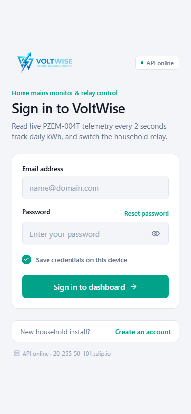
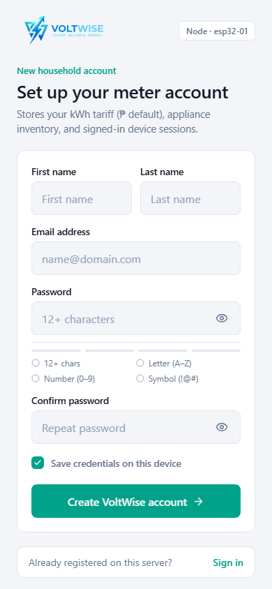
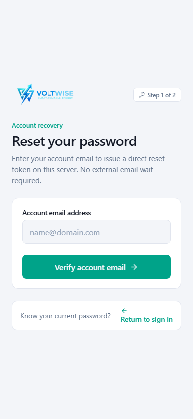

# Account Registration & Sign In

**Who:** Homeowners & Family Members   **You'll need:** Email address, secure password   **Takes:** ~2 minutes

Set up your personal VoltWise account to securely link with your home's smart meter and receive personalized electrical safety alerts.

---

## Steps

1. Launch the VoltWise app from your home screen.
   
   *Enter your registered email address and password.*
   **You should see:** The Sign In screen with fields for Email, Password, and options for "Keep me signed in".

2. If this is your first time using VoltWise, tap **Create an Account**.
   
   *Fill in your First Name, Last Name, Email, and choose a strong password.*
   **You should see:** The registration form with live password-strength indicators.

3. Tap **Sign Up** to create your account credentials.
   **You should see:** A confirmation checkmark and automatic redirection into your home energy dashboard.

4. If you ever forget your credentials, tap **Forgot Password?** on the sign-in screen.
   
   *Enter your account email to receive a password reset code.*
   **You should see:** An instant verification instructions notification.

---

## Expected Result

You are securely authenticated and land on your active **Energy Dashboard**.

---

## If Something Goes Wrong

- **"Invalid credentials" error** — Double-check that your email is typed correctly without trailing spaces. Tap the eye icon to reveal and verify your password.
- **Verification email not received** — Check your spam or promotions folder, or wait 60 seconds before tapping **Resend Code**.
