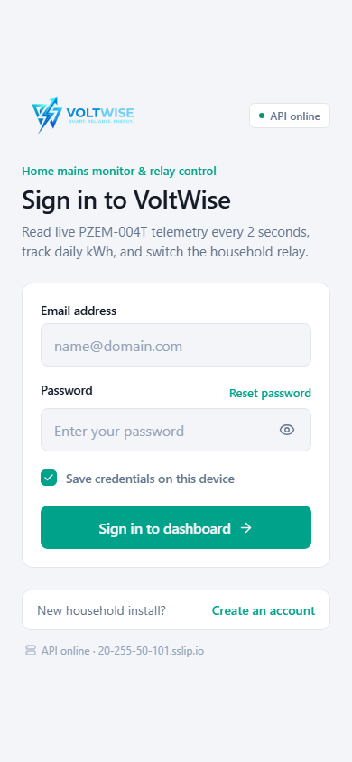

# Consumption Analytics & Bill Estimation

**Who:** Homeowners   **You'll need:** Several days of recorded telemetry   **Takes:** ~2 minutes

Gain visibility into your electricity spending, peak consumption hours, and forecast your end-of-month utility bill using machine learning models.

---

## Steps

1. Tap the **Analytics** tab in the bottom bar.
   
   *Interactive energy usage charts and tariff cost estimations.*
   **You should see:** The energy breakdown view comparing daily, weekly, and monthly kWh usage.

2. Review the **Projected Monthly Bill** card.
   **You should see:** A dollar or peso projection based on current consumption velocity and local utility tariff rates.

3. Tap **Peak Hours** to identify time windows with the highest electricity consumption.
   **You should see:** A visual chart highlighting peak usage intervals (e.g., 6:00 PM – 10:00 PM), allowing you to shift appliance use to off-peak periods.

4. Review the **NILM Disaggregation Breakdown** to see energy split across heating, cooling, refrigeration, and electronics.
   **You should see:** A percentage breakdown calculated by the machine learning engine without requiring smart plugs on every socket.

---

## Expected Result

You understand your home's energy cost trajectory and discover clear opportunities to reduce your utility bills.

---

## If Something Goes Wrong

- **"Insufficient data for projection" message** — The predictive billing engine requires at least 48 hours of continuous telemetry before producing accurate forecasts.
- **Billing rate is inaccurate** — Go to **Settings > Billing & Tariff** to adjust your local electricity utility kilowatt-hour price.
