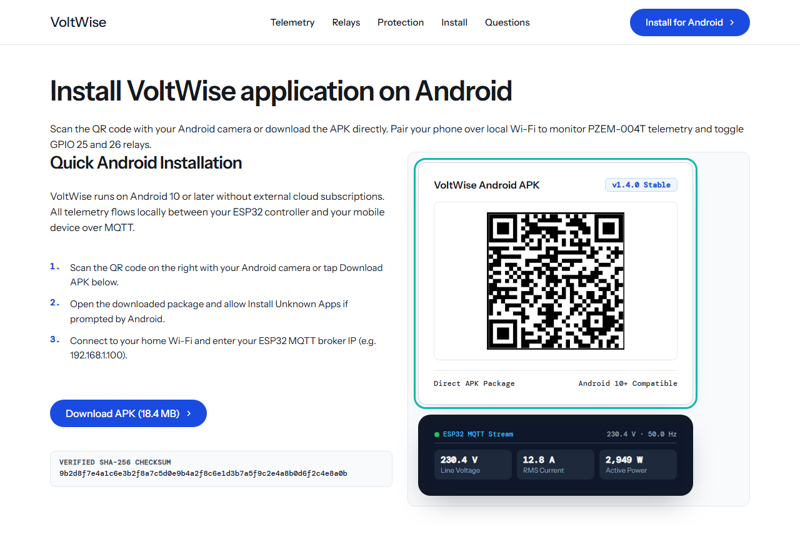

# Installing VoltWise via QR Code & Web

**Who:** Homeowners & Users   **You'll need:** Android smartphone (Android 10+)   **Takes:** ~2 minutes

Get the official VoltWise application installed on your Android device using the live web portal or instant QR code scanner.

---

## Steps

1. Visit the official VoltWise web portal at [`https://voltwise-orcin.vercel.app/`](https://voltwise-orcin.vercel.app/) or navigate down to the **Install** section.
   
   *The QR code card highlights the signed Android APK package.*
   **You should see:** The "Scan the QR code to install VoltWise on Android" banner displaying the QR card and connection requirements.

2. Open the camera or any QR code scanner app on your smartphone, and point the lens directly at the on-screen QR code.
   **You should see:** A download prompt pop up on your device screen pointing to the signed APK file.

3. Tap the prompt to download the installer file and confirm installation permissions if prompted by Android.
   **You should see:** The VoltWise application icon appear on your home screen or application drawer.

4. Tap the **VoltWise** icon to launch the application for the first time.
   **You should see:** The VoltWise themed splash screen loading into the **Sign In** screen.

---

## Expected Result

The VoltWise app is successfully installed on your Android smartphone and opens cleanly to the authentication view.

---

## If Something Goes Wrong

- **QR code doesn't scan automatically** — Ensure your phone screen has adequate brightness and glare is minimized, or tap the **Save the QR code (SVG)** button to save and zoom into the code image.
- **Android blocks the installation ("Unknown Sources")** — In your Android device settings, navigate to **Apps & Notifications > Special App Access > Install Unknown Apps**, and allow permissions for your browser or file manager.
- **App fails to open** — Verify that your device is running Android 10 or newer with active network connectivity.
