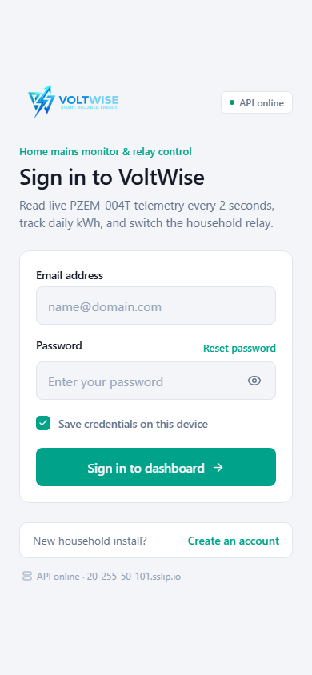

# Connected Appliances & Device Management

**Who:** Homeowners   **You'll need:** Configured appliances   **Takes:** ~3 minutes

Organize your household electrical devices by room, monitor individual appliance wattage, and track vampire loads.

---

## Steps

1. Tap the **Devices** tab in the bottom navigation menu.
   
   *Appliance cards displaying live status, room assignments, and power draw.*
   **You should see:** A list of categorized appliances (e.g., Living Room Air Conditioner, Kitchen Refrigerator, Water Heater).

2. Tap any appliance card to view detailed consumption metrics.
   **You should see:** Individual real-time draw (W), daily runtime hours, and cumulative power usage.

3. To add a new appliance, tap the **+ Add Device** button in the upper header.
   **You should see:** The device registration modal where you can specify appliance name, rated power wattage, and assigned circuit line.

---

## Expected Result

All electrical appliances in your residence are cataloged and monitored individually, allowing you to pinpoint which devices consume the most power.

---

## If Something Goes Wrong

- **Appliance shows 0W while running** — Ensure the appliance is connected through the circuit line monitored by the PZEM-004T current transformer (CT) clamp.
- **Device list is empty** — Tap **+ Add Device** or use the **IoT Provisioning** tool to sync connected devices from your smart meter.
