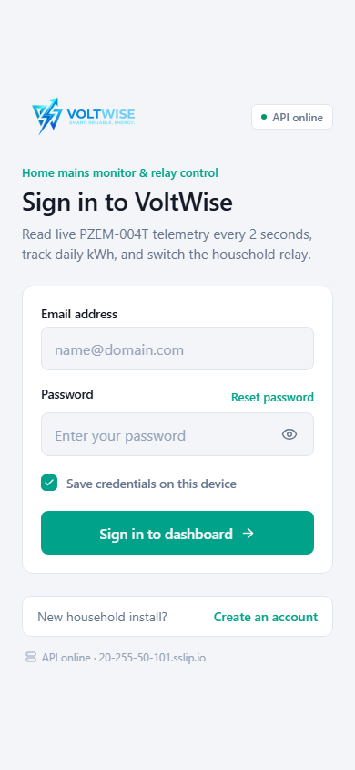
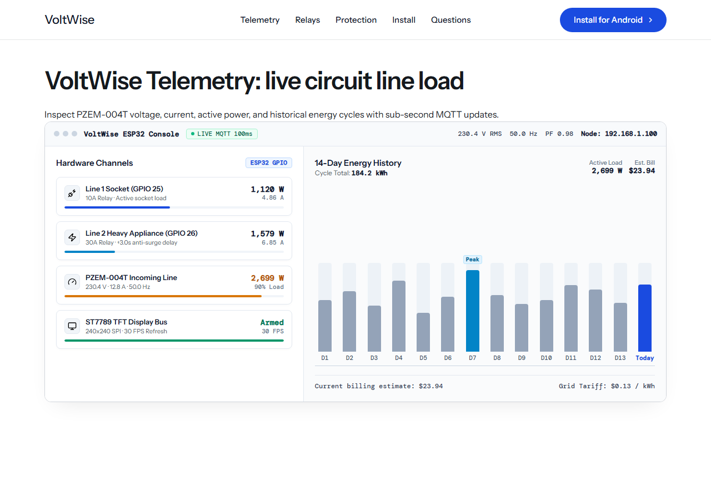

# Real-Time Energy Monitoring

**Who:** Homeowners   **You'll need:** Active internet connection, paired ESP32 meter   **Takes:** Ongoing

Monitor your household's real-time electricity consumption, line voltage, and current load to spot power waste instantly.

---

## Steps

1. Tap the **Dashboard** tab in the bottom navigation bar.
   
   *The top card displays current live wattage and today's energy total.*
   **You should see:** The primary power gauge indicating active power draw (Watts) and today's accumulated kilowatt-hours (kWh).

2. Observe the live telemetry updates streaming from your ESP32 sensor.
   
   *Real-time voltage, current, and active loads across circuit lines.*
   **You should see:** Live updates every 1–3 seconds showing grid voltage (e.g., 230V) and total active amperes.

3. Pull down on the screen at any time to trigger a manual refresh.
   **You should see:** The subtle pull-to-refresh spinner confirming synchronization with the cloud backend.

---

## Expected Result

You have an immediate, continuous view of your home's total power usage, enabling proactive energy conservation.

---

## If Something Goes Wrong

- **Dashboard displays "Connecting..." or 0W** — Ensure your ESP32 hardware is plugged in and the Wi-Fi status LED is steady.
- **Sudden unexplained spike in wattage** — Check high-draw appliances such as water heaters, air conditioners, or ovens.
