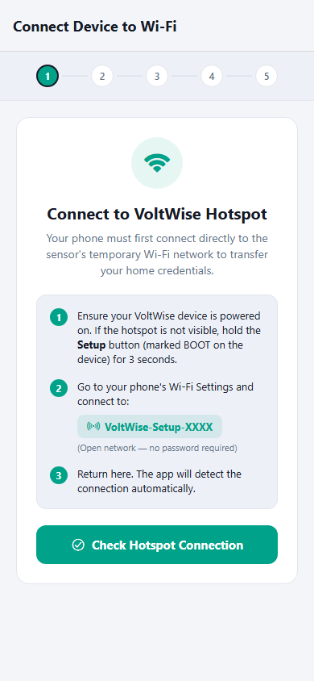
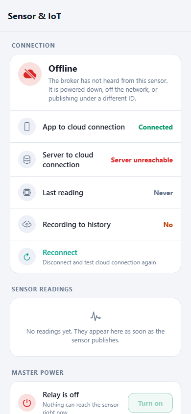

# IoT Hardware Provisioning

**Who:** Homeowner / Installer   **You'll need:** VoltWise ESP32 Energy Monitor & 2.4 GHz Wi-Fi   **Takes:** ~5 minutes

Connect your VoltWise IoT hardware module to your home's Wi-Fi network and link it to your cloud account.

---

## Steps

1. Power on your VoltWise ESP32 device near your main electrical distribution board.
   **You should see:** The onboard ST7789 display light up and broadcast a setup Wi-Fi hotspot named `VoltWise-Setup`.

2. Open the app, navigate to **Settings > IoT Provisioning**.
   
   *Step-by-step setup screen to join the setup access point.*
   **You should see:** The provisioning wizard guiding you to connect your phone to `VoltWise-Setup` (192.168.4.1).

3. Enter your home Wi-Fi SSID and password into the setup prompt, then tap **Pair Device**.
   **You should see:** The hardware status switch from "Connecting" to "Paired & Streaming".

4. Verify or change your MQTT broker connection in **IoT Settings**.
   
   *Device UID, MQTT broker endpoint, and sensor sampling rate settings.*
   **You should see:** Your assigned `DEVICE_UID` and active telemetry link status.

---

## Expected Result

Your VoltWise hardware is securely paired with your home network, transmitting real-time voltage, current, and wattage readings to your app.

---

## If Something Goes Wrong

- **VoltWise-Setup Wi-Fi network not appearing** — Press and hold the reset button on your ESP32 board for 5 seconds to reset Wi-Fi configuration mode.
- **Device fails to connect to home Wi-Fi** — VoltWise requires a 2.4 GHz Wi-Fi frequency. Ensure you are not attempting to connect to a 5 GHz-only network.
