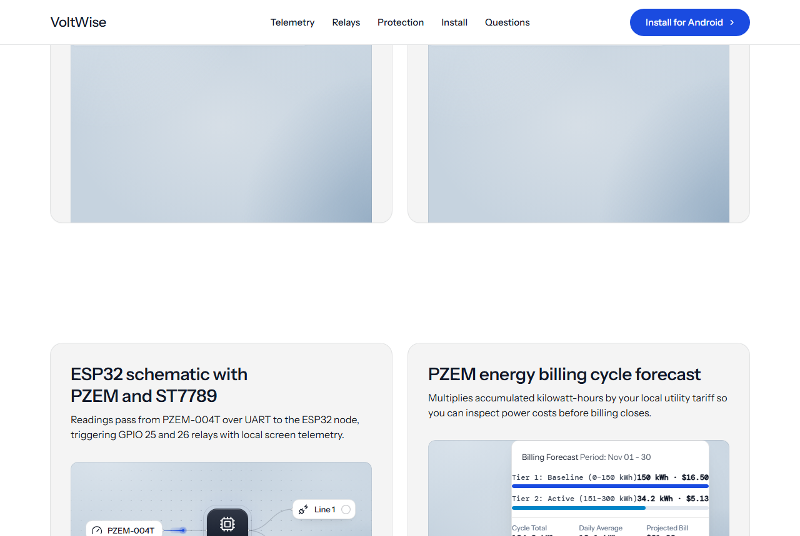

# Emergency Power & Breaker Control

**Who:** Homeowner / System Operator   **You'll need:** Relay hardware connected   **Takes:** ~10 seconds

Remotely shut down electrical circuits or restore power to protect home appliances during severe voltage fluctuations or overloads.

---

## Steps

1. Tap the large center **Power** button in the app navigation bar.
   **You should see:** The **Power Control Modal** appear on top of your current screen, showing Line 1 (10A) and Line 2 (30A) relay switches.

2. Inspect the current relay state and system safety status.
   
   *Dual-relay configuration: 1st line 10A and 2nd line 30A with staggered power-up.*
   **You should see:** Independent toggle switches for both circuits along with clear ON/OFF badges.

3. Tap **Cut Power (Emergency)** if you detect dangerous voltage surges or circuit anomalies.
   **You should see:** A confirmation alert and the relay module tripping within 3 seconds, cutting off supply to connected equipment.

4. To restore power, toggle the relay back on and wait for the 3-second staggered reboot delay.
   **You should see:** Circuit voltage stabilize and appliances return to operational status.

---

## Expected Result

You can instantly isolate high-draw or faulty circuits from your smartphone, preventing damage or electrical fire hazards.

---

## If Something Goes Wrong

- **Relay button does not respond** — Check that the ESP32 controller has active MQTT connection to the VoltWise broker.
- **Relay trips immediately upon restoring power** — An appliance on that circuit may have an electrical short; unplug appliances one by one before resetting the breaker.
