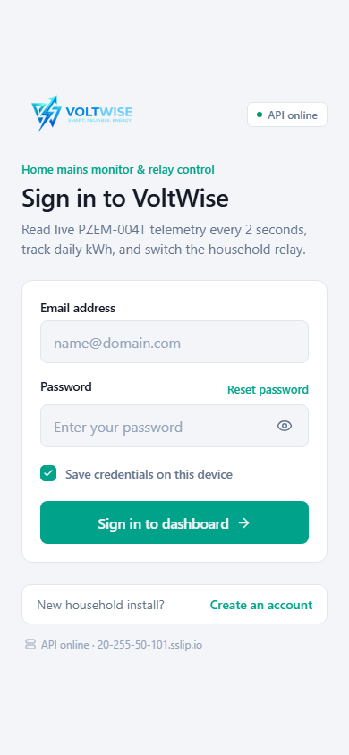
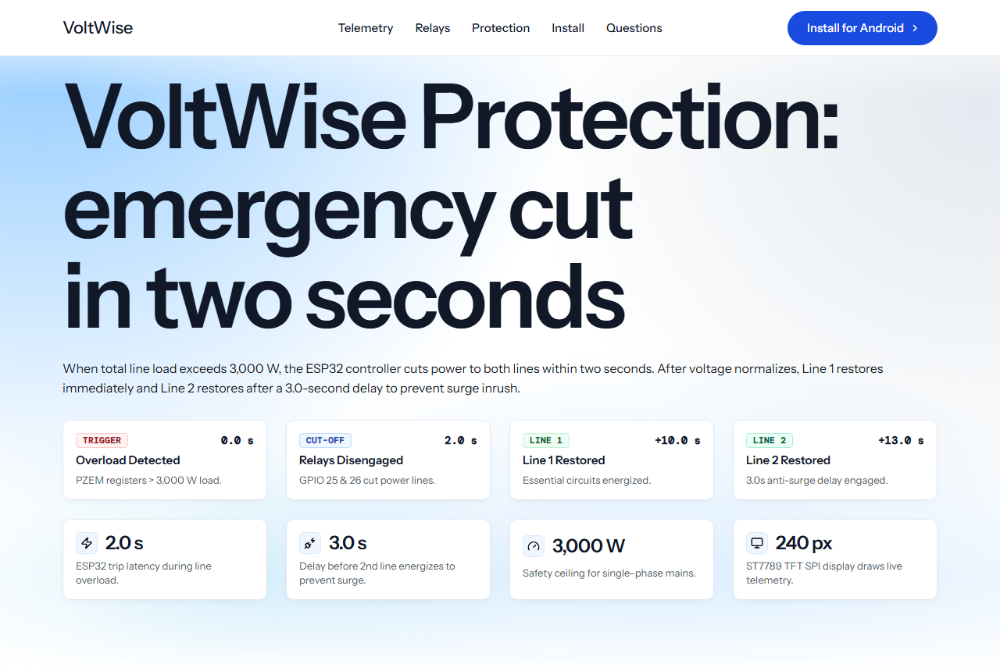

# Automated Safety Alerts & Interventions

**Who:** Homeowners   **You'll need:** Enabled push notifications   **Takes:** Immediate

Protect your home against electrical fires, appliance damage from voltage spikes, and energy theft through automated anomaly detection.

---

## Steps

1. Tap the **Alerts** tab in the bottom navigation bar.
   
   *Prioritized alert cards: Overload, Voltage Surge, and Vampire Drain.*
   **You should see:** A chronological log of recent alerts marked with severity indicators (Warning, Critical, Info).

2. When an electrical anomaly occurs, VoltWise initiates an immediate safety intervention.
   
   *Rapid emergency protection cutting circuit power within seconds.*
   **You should see:** An urgent warning notification with a 3–10 second alert countdown before the relay trips the circuit.

3. Tap **Acknowledge** or **Cancel Shutdown** if the high draw was intentional (e.g., starting a high-capacity power tool).
   **You should see:** The shutdown timer abort and the alert marked as reviewed.

4. Swipe left on resolved notifications to clear them from your inbox.
   **You should see:** The alert card dismissed and the unread alerts badge count decrement.

---

## Expected Result

Your home electrical circuits are actively defended against surges, overcurrent, and dangerous anomalies 24 hours a day.

---

## If Something Goes Wrong

- **Frequent false overload alarms** — Adjust your circuit amperage threshold under **Settings > Alert Thresholds** to match your household breaker rating.
- **Alert sounds muted while sleeping** — Check **Settings > Notification Preferences** to ensure Critical Safety Alerts are exempt from Quiet Hours.
