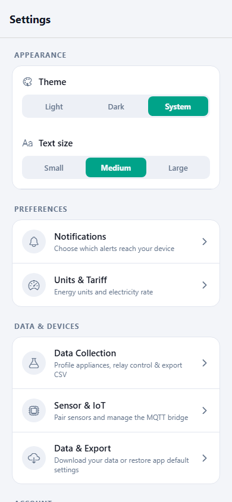
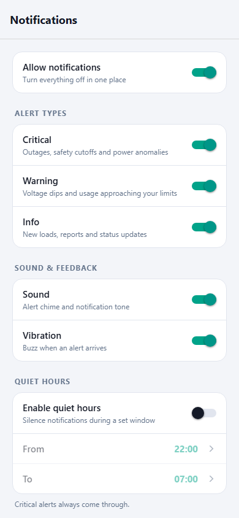

# App Preferences & Settings

**Who:** Homeowners   **You'll need:** Configured app   **Takes:** ~2 minutes

Customize notification sounds, configure quiet hours, set power measurement units, and manage your account profile.

---

## Steps

1. Tap **Settings** in the app header or drawer.
   
   *Configuration menu for notifications, measurement units, and account details.*
   **You should see:** Grouped preference sections for Account, Alerts, Display, and Hardware.

2. Tap **Notification Settings** to fine-tune how and when you receive alerts.
   
   *Toggle push alerts, configure quiet hours, and set sound effects.*
   **You should see:** Options to enable/disable sound effects (e.g., warning beeps), define Quiet Hours intervals, and choose vibration haptics.

3. Tap **Units & Tariff Settings** to adjust measurement standards (e.g., kW vs. W, currency symbol, and kWh pricing).
   **You should see:** Instant updates reflected across your dashboard and analytics charts.

---

## Expected Result

The VoltWise app is customized to your personal schedule, alert preferences, and local utility tariff structure.

---

## If Something Goes Wrong

- **Settings revert after closing the app** — Ensure you have active internet connection so your preferences can sync to your cloud account.
- **Haptic feedback not working** — Verify that system vibration is enabled in your Android OS accessibility settings.
